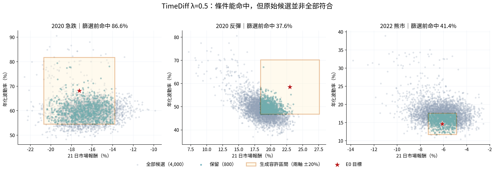
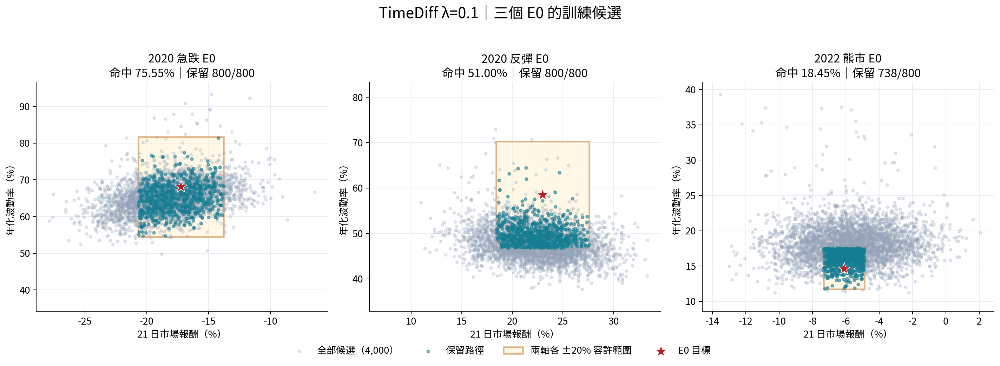
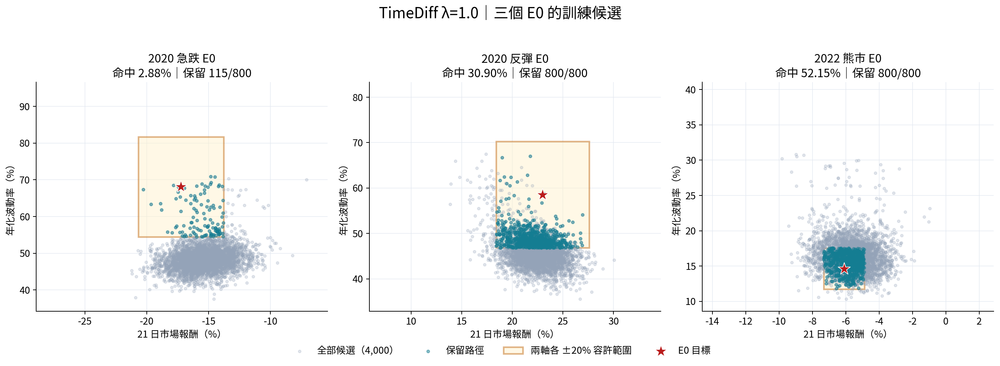
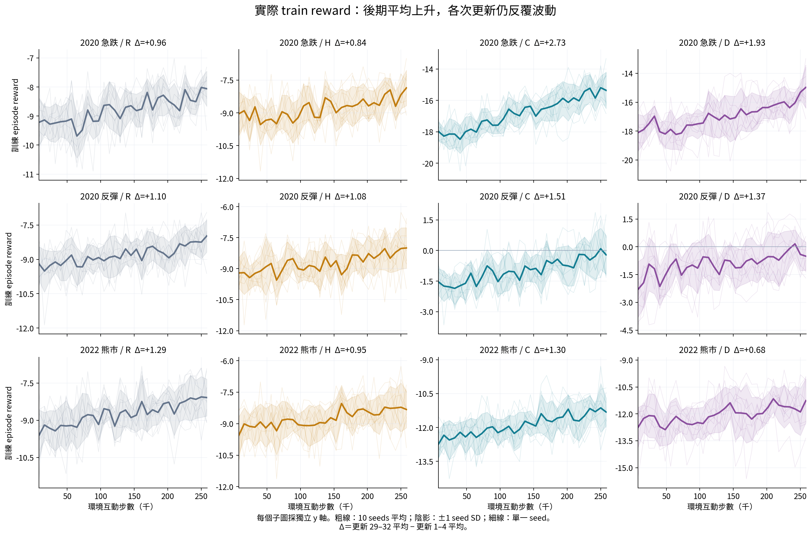
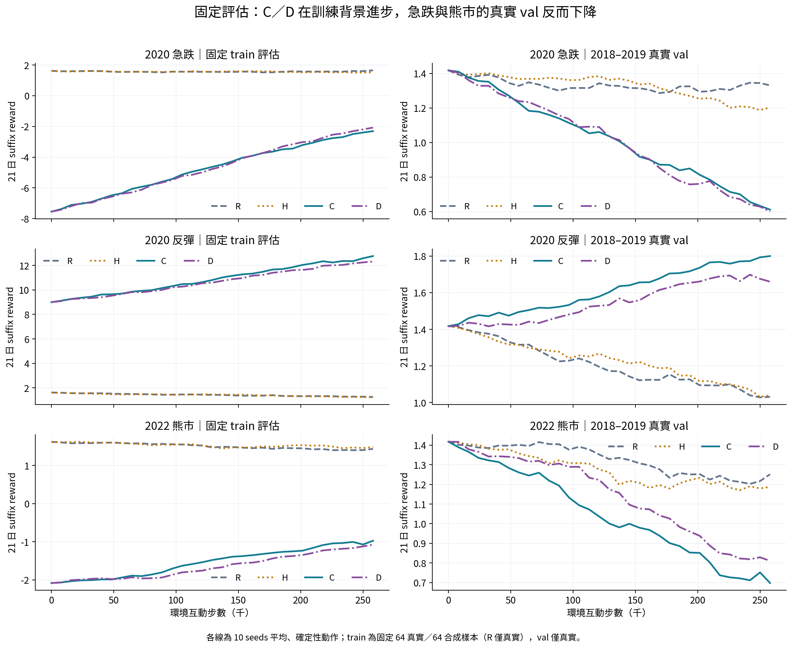
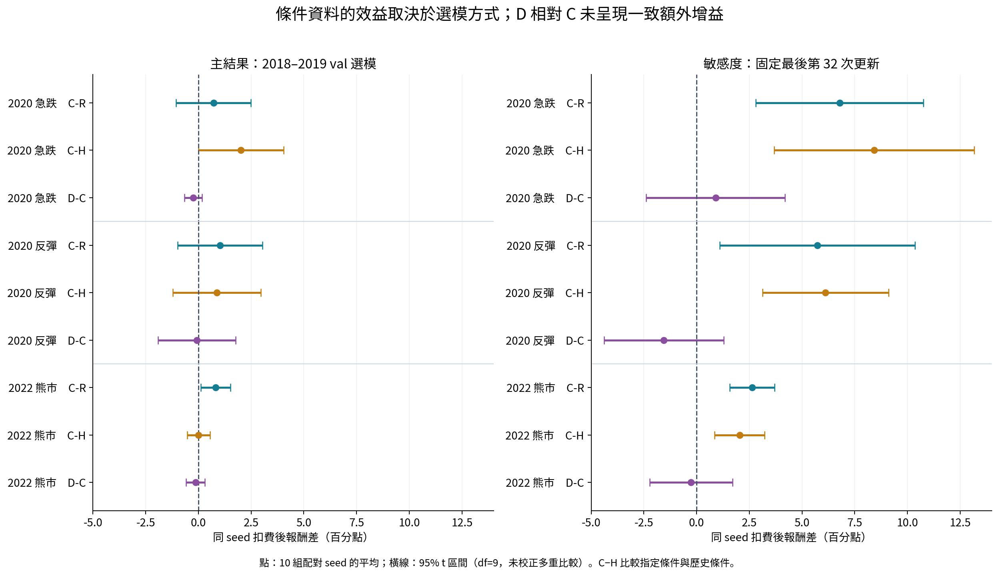
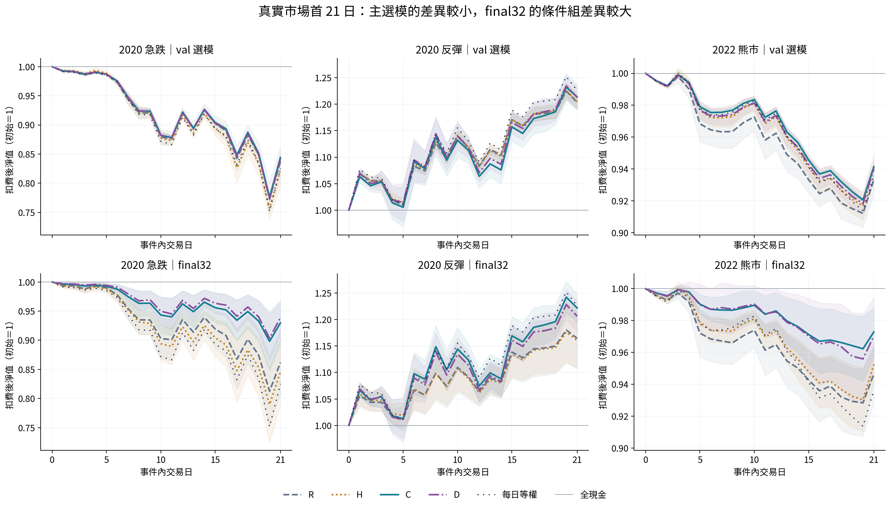
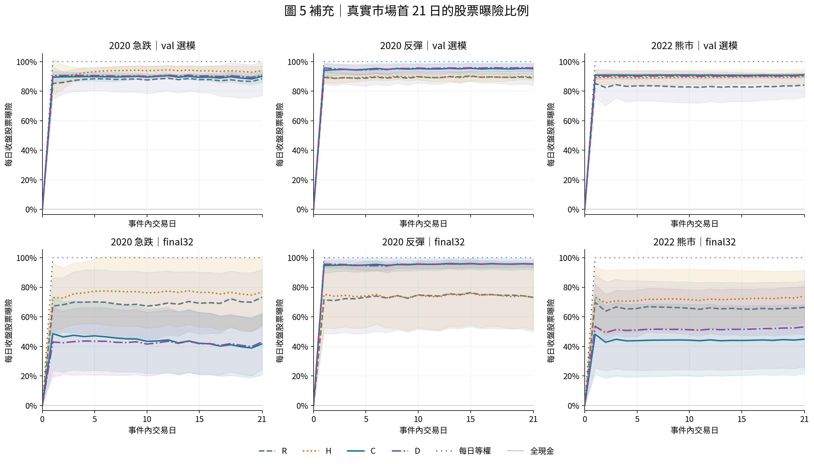

# TimeDiff × PPO｜三情境 E0・10 Seeds 實驗報告

TimeDiff λ=0.5・三情境 E0・PPO seeds 1–10｜整理日期：2026-11-16

## 結果摘要

| 要回答的問題 | 本輪結論 | 關鍵證據 |
| --- | --- | --- |
| TimeDiff 是否符合預期？ | <b>達到指定條件與數量；尚不能視為完整行情已逼真。</b> | 3,600 條保留路徑均通過報酬／波動各 ±20% 的篩選；18,000 候選中 56.4% 命中。High／Low 仍需修正。 |
| PPO train reward 有穩步上升嗎？ | <b>有整體改善</b> | 114/120 模型末四次更新平均高於前四次 |
| 指定測試條件有改善真實 test 嗎？ | <b>主選模證據有限；固定 final32 有一致的條件效益。</b> | 主選模 C−H 三個 95% 區間都含零；final32 的 C−H 為 +8.42／+6.12／+2.04 百分點，三個區間均大於零。D 尚無穩定額外效益。 |

<b>解讀範圍：</b>E0 條件使用對應真實事件首 21 日的事後報酬與波動，屬情境機制實驗。10 seeds 只改變 PPO 隨機性，使用相同生成資料與三段行情；區間不代表對未來市場的保證。

| 組別 | 用來隔離的差異 |
| --- | --- |
| R | 只用真實訓練資料。 |
| H | 真實＋歷史條件合成資料，隨機切換。 |
| C | 真實＋當次 E0 條件合成資料，隨機切換。 |
| D | 與 C 相同資料與互動預算，有限度重複環境、收集新 rollout。 |

## 1｜TimeDiff 生成品質



圖 1｜每情境的 4,000 條訓練候選全部繪出；藍綠點為保留 800 條，紅星為 E0 目標，橙框為生成容許範圍。兩軸分別以單一目標為分母，允許 ±20%；這是生成誤差，E0 本身沒有分析師誤差。來源 \[1\]。

<details>
<summary>展開：λ=0.1 生成散布圖</summary>



同樣使用三個 E0、每情境 4,000 個 train 候選與兩軸各 ±20% 門檻。急跌／反彈／熊市命中率為 75.55%／51.00%／18.45%；熊市保留 738／800 條，未達配額。補充圖採三版本共同座標範圍，完整呈現所有候選。

來源：<code>/home/cwei1213/TimeDiff/outputs/dow10/conditional/scenario_pilot/run_20261114/generation</code>。
</details>

<details>
<summary>展開：λ=1.0 生成散布圖</summary>



同樣使用三個 E0、每情境 4,000 個 train 候選與兩軸各 ±20% 門檻。急跌／反彈／熊市命中率為 2.88%／30.90%／52.15%；急跌僅保留 115／800 條，未達配額。補充圖採三版本共同座標範圍，完整呈現所有候選。本頁 PPO 結果仍使用 λ=0.5。

來源：<code>/mnt/sda/cwei1213/timediff_finrl/lambda_extension_20261116/lambda_1p0/generation</code>。
</details>

| 情境 | train 命中率 | 2018 命中率 | 2019 命中率 | 保留條數：train / 2018 / 2019 |
| --- | --- | --- | --- | --- |
| 2020 急跌 | 86.6% | 83.5% | 82.4% | 800 / 200 / 200 |
| 2020 反彈 | 37.6% | 35.0% | 37.6% | 800 / 200 / 200 |
| 2022 熊市 | 41.4% | 57.5% | 57.8% | 800 / 200 / 200 |

命中率的分母分別為 4,000／1,000／1,000 個候選，判定需同時符合報酬、波動。每個分割的保留率皆為候選的 20%，數量達成率皆為 100%；保留量受配額限制，不能當成原始命中率。本輪 PPO 將 2018＋2019 的 400 條合併為 val；2019 不是獨立 test。

| 訓練保留路徑 | 報酬：目標 → 生成平均 | 年化波動：目標 → 生成平均 | 相關：生成 / 對應真實事件 | High / Low 修正比例 |
| --- | --- | --- | --- | --- |
| 2020 急跌 | -17.24% → -16.68% | 68.12% → 60.11% | 0.818 / 0.882 | 10.3% / 10.1% |
| 2020 反彈 | +23.00% → +19.78% | 58.53% → 49.67% | 0.753 / 0.697 | 19.3% / 5.2% |
| 2022 熊市 | -6.11% → -6.02% | 14.64% → 15.72% | 0.184 / 0.210 | 15.5% / 20.7% |

<b>條件大致可控，仍有中心偏差。</b>反彈目標是 +23.00%／58.53%，保留平均為 +19.78%／49.67%，集中在允許範圍下緣。合成與真實事件的平均跨資產相關相近，但 21 日相關估計很短，單一平均值也不足以驗證整個相關矩陣。

<b>基本可用性通過。</b>三個 E0 的候選無非有限／非正價格失敗；保留路徑通過 HLC 合法性與接續檢查，分割內未發現完全重複路徑或逐背景真實未來的直接複製。High／Low 修正比例約 5.2%–20.7%，因此合法性部分依賴後處理；來源與模型都沒有 Open。這些檢查不等於已證明經濟多樣性或 RL 效益。

<details>
<summary>展開：目標值、合法區間與多樣性明細</summary>

| 情境 | 真實條件／test 日期 | 報酬合法範圍 | 波動合法範圍 |
| --- | --- | --- | --- |
| 2020 急跌 | 2020-02-13～2020-03-13 | \[-20.69%, -13.80%\] | \[54.49%, 81.74%\] |
| 2020 反彈 | 2020-03-17～2020-04-15 | \[+18.40%, +27.60%\] | \[46.82%, 70.24%\] |
| 2022 熊市 | 2021-12-30～2022-01-28 | \[-7.33%, -4.89%\] | \[11.71%, 17.57%\] |

市場報酬為 Dow 10 每日等權簡單報酬的連乘；年化波動為 21 個市場日對數報酬的樣本標準差 × √252。跨資產相關以 10 股票日對數報酬的 45 組配對 Pearson 相關取平均。

| 情境 | 訓練獨特背景 / 路徑數 | 每背景最多保留 | 完全重複 | 背景真實參考相關 |
| --- | --- | --- | --- | --- |
| 2020 急跌 | 698 / 800 | 5 | 0% | 0.348 |
| 2020 反彈 | 694 / 800 | 3 | 0% | 0.348 |
| 2022 熊市 | 694 / 800 | 4 | 0% | 0.349 |

跨資產相關的「背景真實參考」來自各合成背景的歷史未來，與情境行情不同；主表改用對應事件首 21 日作比較，避免把情境相關性變化直接判成失真。生成最多配額的 5 倍，不放寬篩選條件。
</details>

## 2｜PPO train reward 的上升是否穩定？



圖 2｜真正訓練時的隨機動作 episode reward：每次更新記錄最近 100 個完整 episode 的平均，包含 k 日前置交易＋21 日後段。粗線為 10 seeds 平均、細線為各 seed、陰影為 ±1 seed 標準差；資料來自主實驗 120 份 updates.csv，沒有混入 D 校準。每個子圖採獨立 y 軸範圍，跨圖請依軸上數值比較。來源 \[2\]。

| 情境 | 組別 | 前四次 → 末四次 reward | 改善量 | 改善 seeds | 相鄰更新上升比例 |
| --- | --- | --- | --- | --- | --- |
| 2020 急跌 | R | -9.22 → -8.26 | +0.96 | 10/10 | 53.5% |
| 2020 急跌 | H | -9.01 → -8.17 | +0.84 | 10/10 | 53.5% |
| 2020 急跌 | C | -18.13 → -15.40 | +2.73 | 10/10 | 52.6% |
| 2020 急跌 | D | -17.61 → -15.68 | +1.93 | 10/10 | 53.2% |
| 2020 反彈 | R | -9.27 → -8.17 | +1.10 | 10/10 | 51.6% |
| 2020 反彈 | H | -9.26 → -8.18 | +1.08 | 10/10 | 48.7% |
| 2020 反彈 | C | -1.73 → -0.22 | +1.51 | 10/10 | 51.6% |
| 2020 反彈 | D | -1.59 → -0.21 | +1.37 | 9/10 | 53.2% |
| 2022 熊市 | R | -9.39 → -8.10 | +1.29 | 10/10 | 50.3% |
| 2022 熊市 | H | -9.22 → -8.27 | +0.95 | 8/10 | 52.3% |
| 2022 熊市 | C | -12.52 → -11.23 | +1.30 | 10/10 | 53.9% |
| 2022 熊市 | D | -12.30 → -11.62 | +0.68 | 7/10 | 51.9% |

<b>有學習趨勢。</b>12 個「情境×組別」平均都改善，但 6 個個別 seed 未改善。末期隨機訓練 reward 仍為負；reward 的改善不能直接解讀成真實 test 獲利。不同組的訓練行情不同，表格適合比較各組自身前後，跨組絕對水準需搭配相同真實 test。



圖 3｜確定性動作、固定樣本的評估 reward，與圖 2 的隨機訓練 reward 分開。左圖為固定 train 樣本（C／D 含指定條件合成資料），右圖只用 2018–2019 真實 val；均取最後 21 日 suffix，曲線為 10 seeds 平均，圖間縱軸依各評估範圍顯示。來源 \[3\]。

| 情境 | 組別 | 固定 train：update32 − 初始化 | 真實 val：update32 − 初始化 |
| --- | --- | --- | --- |
| 2020 急跌 | C | +5.24 | -0.81 |
| 2020 急跌 | D | +5.47 | -0.82 |
| 2020 反彈 | C | +3.77 | +0.38 |
| 2020 反彈 | D | +3.32 | +0.24 |
| 2022 熊市 | C | +1.11 | -0.72 |
| 2022 熊市 | D | +1.00 | -0.61 |

C／D 的固定 train 評估皆改善；急跌、熊市的真實 val 卻下降，反彈才同向上升。<b>這表示情境資料上的學習沒有普遍轉成一般真實 val 的改善</b>；是否有益於指定情境，需看下一節的真實事件測試。

<details>
<summary>展開：reward、平滑與「穩步」的判讀方式</summary>

單日 reward = 100 × log(Vₜ/Vₜ₋₁)，V 已扣交易成本。圖 2 是完整 k＋21 日 episode 的 reward 和、再對最近 100 個 episode 平均；同一批記錄收於當次梯度更新之前，因此圖 2 的 update u 對應更新 u−1 策略收集到的 rollout。圖 3 是 checkpoint u 的確定性評估。

本報告以更新 1–4 與 29–32 的平均作等長前後比較；相鄰上升比例則逐 seed 計算 31 個差分，再合計 10 seeds 共 310 個差分。這是描述性比例，rolling mean 與更新序列彼此相關，沒有把它們當成獨立樣本做顯著性檢定。沒有額外移動平均、裁去不利更新或只挑成功 seed。

圖 3 的固定 train 評估使用 64 條真實、64 條合成路徑（R 僅真實），依來源比例混合；所有曲線只評最後 21 日。真實 val 覆蓋 2018–2019 24 個目標窗，對每個窗平均全部 22 種 k。預測、k 與資料來源標籤都未放入觀測。
</details>

## 3｜指定測試條件的資料，是否改善真實 test？

### 主結果：以 2018–2019 真實 val 選 checkpoint

| 情境 | R | H | C | D | 每日等權 |
| --- | --- | --- | --- | --- | --- |
| 2020 急跌 | -16.34 ± 2.61% | -17.64 ± 2.91% | -15.63 ± 0.62% | -15.87 ± 0.37% | -17.50% |
| 2020 反彈 | +20.33 ± 1.29% | +20.47 ± 1.39% | +21.35 ± 2.42% | +21.27 ± 1.83% | +22.59% |
| 2022 熊市 | -6.68 ± 0.99% | -5.87 ± 0.78% | -5.86 ± 0.09% | -6.00 ± 0.61% | -6.39% |

表中為真實事件首 21 日扣費後簡單報酬，平均 ± 10 seeds 標準差；全現金基準三情境皆為 0%。每日等權也扣相同費率與初次建倉費用。主選模允許選到初始化，依 val 平均 suffix reward 最高且同分較早的 checkpoint；未按 test 損益選模。來源 \[4\]。



圖 4｜相同 seed 配對相減，單位為百分點。C−R 回答加入指定情境合成資料的效益；<b>C−H 隔離指定條件相對於一般歷史條件的效益</b>；D−C 檢驗重複環境的額外效益。橫線為 95% t 區間，僅反映 PPO seeds 差異，未校正多重比較。來源 \[4\]，C−H 為本報告從逐 seed 表重新計算。

| 情境 | 配對比較 | 平均差（百分點） | 95% t 區間 | 勝／平／負 |
| --- | --- | --- | --- | --- |
| 2020 急跌 | C-R | +0.713 | \[-1.054, +2.481\] | 6/0/4 |
| 2020 急跌 | C-H | +2.018 | \[-0.005, +4.040\] | 6/1/3 |
| 2020 反彈 | C-R | +1.020 | \[-0.994, +3.033\] | 6/0/4 |
| 2020 反彈 | C-H | +0.880 | \[-1.209, +2.970\] | 6/0/4 |
| 2022 熊市 | C-R | +0.814 | \[+0.107, +1.522\] | 8/1/1 |
| 2022 熊市 | C-H | +0.006 | \[-0.530, +0.543\] | 2/4/4 |

<b>主選模尚未支持三情境都有穩定的條件優勢。</b>C−R 只有熊市區間全為正；C−H 三個區間皆涵蓋零，急跌下界約 −0.005 百分點，不能四捨五入成零後當成已確認優勢。

### 固定 final32：事先指定的敏感度分析

| 情境 | R | H | C | D | 每日等權 |
| --- | --- | --- | --- | --- | --- |
| 2020 急跌 | -13.81 ± 5.40% | -15.45 ± 5.79% | -7.03 ± 3.80% | -6.13 ± 2.66% | -17.50% |
| 2020 反彈 | +16.44 ± 5.75% | +16.05 ± 5.15% | +22.17 ± 2.65% | +20.62 ± 2.86% | +22.59% |
| 2022 熊市 | -5.36 ± 1.83% | -4.75 ± 1.00% | -2.71 ± 1.50% | -2.97 ± 2.40% | -6.39% |

| 情境 | 配對比較 | 平均差（百分點） | 95% t 區間 | 勝／平／負 |
| --- | --- | --- | --- | --- |
| 2020 急跌 | C-H | +8.42 | \[+3.68, +13.16\] | 9/0/1 |
| 2020 反彈 | C-H | +6.12 | \[+3.12, +9.11\] | 9/0/1 |
| 2022 熊市 | C-H | +2.04 | \[+0.86, +3.22\] | 9/0/1 |

<b>同樣訓練到 258,048 步時，指定條件資料有正向機制證據。</b>C−R 三情境平均差為 +6.78／+5.73／+2.64 百分點，C−H 如表也全為正，三情境各有 9/10 seeds 勝過 H。這支持「這組 E0 資料有幫助」，但敏感度分析不能事後取代原定主結果。D−C 在兩套選模、三情境的區間皆含零，未確認 D 的額外優勢。



圖 5｜兩套 checkpoint 在同一真實市場首 21 日的扣費後淨值；線為 10 seeds 平均，陰影為 ±1 seed 標準差。全現金與每日等權作基準。每個子圖從初始淨值 1、全現金起步；圖間採各情境的價格變動範圍，不表示不同事件有相同風險。來源 \[4\]。



圖 5 補充｜與圖 5 相同的 checkpoint、真實事件首 21 日及 seeds 1–10；上排為主選模、下排為 final32，R／H／C／D 顏色與線型一致。縱軸為每日收盤實際股票市值占帳戶淨值的比例（end\_stock\_exposure），其餘為現金；第 0 日皆為全現金。線為 10 seeds 平均，陰影為 ±1 seed 標準差；標準差帶可略高於 100%，實際持倉均在 0–100%。全現金與每日等權分別為 0% 與建倉後 100%。來源 \[4\]。

final32 的 C／D 在急跌與熊市平均股票曝險約 42–52%，反彈約 95%；主選模的 C／D 仍約 90–95%。下跌時的較低曝險與圖 5 的較小損失相符，但曝險也包含價格漂移，單憑此圖不能證明已學會指定的主動加減碼行為。

### 為何主結果與 final32 差這麼多？

| 主選模選到初始化 | R | H | C | D |
| --- | --- | --- | --- | --- |
| 2020 急跌 | 3/10 | 2/10 | 4/10 | 4/10 |
| 2020 反彈 | 2/10 | 4/10 | 0/10 | 0/10 |
| 2022 熊市 | 1/10 | 4/10 | 8/10 | 4/10 |

120 個模型有 <b>36 個選到尚未訓練的初始化</b>，熊市 C 更達 8/10；這是資料中的選模結果。搭配圖 3，合理推測一般 2018–2019 val 與指定情境的目標不完全一致，導致部分學到的情境策略沒有被選用。此機制仍需另設實驗驗證；本報告不因 test 結果改選模規則。

<details>
<summary>展開：全部 D 配對比較與風險／成本</summary>

<b>主選模</b>

| 情境 | 配對比較 | 平均差（百分點） | 95% t 區間 | 勝／平／負 |
| --- | --- | --- | --- | --- |
| 2020 急跌 | D-R | +0.47 | \[-1.38, +2.32\] | 5/1/4 |
| 2020 急跌 | D-H | +1.77 | \[-0.35, +3.89\] | 7/0/3 |
| 2020 急跌 | D-C | -0.25 | \[-0.66, +0.17\] | 3/2/5 |
| 2020 反彈 | D-R | +0.94 | \[-0.35, +2.24\] | 8/0/2 |
| 2020 反彈 | D-H | +0.80 | \[-0.61, +2.22\] | 7/0/3 |
| 2020 反彈 | D-C | -0.08 | \[-1.92, +1.77\] | 4/0/6 |
| 2022 熊市 | D-R | +0.67 | \[-0.14, +1.49\] | 7/1/2 |
| 2022 熊市 | D-H | -0.13 | \[-0.84, +0.57\] | 3/1/6 |
| 2022 熊市 | D-C | -0.14 | \[-0.59, +0.31\] | 2/4/4 |

<b>final32</b>

| 情境 | 配對比較 | 平均差（百分點） | 95% t 區間 | 勝／平／負 |
| --- | --- | --- | --- | --- |
| 2020 急跌 | D-R | +7.68 | \[+3.27, +12.09\] | 9/0/1 |
| 2020 急跌 | D-H | +9.32 | \[+4.55, +14.08\] | 9/0/1 |
| 2020 急跌 | D-C | +0.90 | \[-2.38, +4.18\] | 5/0/5 |
| 2020 反彈 | D-R | +4.17 | \[+0.74, +7.60\] | 9/0/1 |
| 2020 反彈 | D-H | +4.56 | \[+0.32, +8.80\] | 7/0/3 |
| 2020 反彈 | D-C | -1.55 | \[-4.39, +1.28\] | 3/0/7 |
| 2022 熊市 | D-R | +2.38 | \[+0.49, +4.28\] | 9/0/1 |
| 2022 熊市 | D-H | +1.78 | \[+0.19, +3.37\] | 8/0/2 |
| 2022 熊市 | D-C | -0.26 | \[-2.22, +1.70\] | 5/0/5 |

<b>主選模風險與持倉</b>

| 情境 | 組別 | 平均最大回撤 | 平均交易成本／初始資金 | 平均股票曝險 |
| --- | --- | --- | --- | --- |
| 2022 熊市 | C | -7.94% | 0.275% | 90.8% |
| 2022 熊市 | D | -8.17% | 0.300% | 90.2% |
| 2022 熊市 | H | -8.44% | 0.307% | 89.4% |
| 2022 熊市 | R | -8.89% | 0.362% | 83.3% |
| 2020 急跌 | C | -22.40% | 0.295% | 89.6% |
| 2020 急跌 | D | -22.72% | 0.291% | 90.3% |
| 2020 急跌 | H | -24.31% | 0.390% | 93.2% |
| 2020 急跌 | R | -22.52% | 0.357% | 87.6% |
| 2020 反彈 | C | -7.36% | 0.467% | 95.0% |
| 2020 反彈 | D | -7.25% | 0.463% | 95.4% |
| 2020 反彈 | H | -5.49% | 0.374% | 89.5% |
| 2020 反彈 | R | -5.52% | 0.377% | 89.3% |

最大回撤以負值呈現；交易成本為本段累計費用除初始資金。兩個下跌情境中，急跌與熊市各組仍虧損，均未勝過全現金；兩套選模的反彈平均也未勝過每日等權，不能把相對 R／H 改善解讀為已勝過所有基準。
</details>

<details>
<summary>展開：實驗設定與執行步驟</summary>

| 項目 | 設定 |
| --- | --- |
| TimeDiff | λ(condition loss)=0.5；63 日歷史生成 21 日；固定 AR、停用 future mixup。生成器訓練 2005–2017、2018 選模；本輪未重訓或更換權重。 |
| 情境 | 只用急跌、反彈、熊市三個 E0 的首 21 日，條件是該窗口實現的報酬與波動。未做 E1、完整事件分段預測或連續帳戶更新。 |
| PPO train | 2005–2017；真實 3,181 條、每情境合成 798 條、H 歷史合成 800 條。原本 800 條 E0 中有 2 條無法在訓練分割提供 71 日歷史，沿用既有排除紀錄。 |
| PPO val | 2018-01-01～2019-12-31，實際 503 個交易日。24 個完整 21 日目標窗，尾窗重疊 1 日；過去觀測可來自 2017。合成 val 為 2018 的 200 條＋2019 的 200 條。 |
| 隨機插入 | 50 日初始觀測 → k 個真實交易日 → 21 個真實／合成交易日；每次 reset 的 k 在整數 0–21 均勻抽樣。不是 k\_max=0。 |
| 資料比例 | H／C／D 一半來源 episode 為合成，成對真實／合成環境共用 k 序列。前置 k 日仍是真實價格，因此實際合成價格步數約三分之一。 |
| 模型與資產 | PPO＋EIIE CNN；Dow 10＋現金，long-only、無槓桿。觀測 50 日 HLC＋前次實際配置；預測值不進入 PPO 觀測。 |
| PPO 預算 | 每模型 16 env × 504 steps × 32 更新 = 258,048 步；每次更新 10 epochs，batch 504。lr 3e-4、γ 0.99、GAE 0.95、clip 0.2。 |
| 種子與配對 | 3 情境 × R／H／C／D × seeds 1–10＝120 模型；同 seed 各組同初始權重，C／D 同資料、k 序列與互動預算；不跨情境移轉。seed 0 只校準、不納入正式比較。 |
| reward／費用 | 100 × log(扣費後淨值比)，訓練與測試費率同為 0.0025（0.25%）；初始全現金，初次建倉計費。 |
| D 校準 | seed 0 用新 val 比較重複 1／2／4／8 次並檢查較大池；鎖定 8 真實＋8 合成、最短 2／最長 4 次更新，改善 0.040891、驗證退步 0.059320、patience 2。重新走同一路徑收集新 rollout。 |
| 選模 | 主結果取真實 val 最高 checkpoint，同分較早、可取初始化；final32 是事先指定敏感度。兩套名單在事件策略損益計算前鎖定。 |
| test | 只用表列首 21 日的真實價格；確定性動作、全現金開始、無額外 k 交易、無窗口續訓。 |
| 執行 | tmux 完成、exit 0；CPU 8 workers × 2 threads；含校準與主訓練／回測約 53.5 分鐘，不含事前程式與計時準備。 |

<b>步驟：</b>①核對既有 λ=0.5 生成資料並建立固定訓練銀行；②以 seed 0、新 val 校準 D 並鎖定參數；③重新初始化訓練 120 模型、每次更新評估 val；④鎖定主選模與 final32 清單；⑤在對應真實首 21 日做扣費回測；⑥本報告重算生成命中、實際 rollout 趨勢與配對差。
</details>

<details>
<summary>展開：統計與實驗限制</summary>

- 所有 seed 比較在同一事件與同一生成銀行內配對。95% 區間＝平均差 ± t(0.975,9) × 配對差標準差／√10，未做多重比較校正，屬探索性證據。
- 三個事件分別解讀，不把它們合成 30 個獨立市場樣本；seed 只代表 PPO 初始化與訓練抽樣變動，未涵蓋生成種子、條件誤差或未來市場不確定性。
- E0 使用已知的未來實現值，seed 0 的事件績效在先前開發亦已被看過；這輪不能宣稱真正前瞻、從未觀察的測試或分析師能力。
- 2019 已依這次指示納入 val，報告沒有把原檔名 test 的 2019 合成背景再宣稱為獨立測試。真正 test 只有三個首 21 日真實事件。
- 合成資料經條件篩選，保留路徑 100% 通過不代表原始生成 100% 成功；沒有完全重複也不證明情境多樣性足夠。
- 本報告回答生成、reward 與真實測試表現；沒有把全現金／高曝險或 reward 上升當成已驗證「反彈減碼／回撤加碼」行為。
</details>

<details>
<summary>展開：來源、圖表數據與重現方式</summary>

| 來源 | 本機原始依據 | 本報告用途 |
| --- | --- | --- |
| \[1\] TimeDiff 生成 | TimeDiff/outputs/dow10/conditional/scenario\_pilot/loss\_ablation\_20261115/lambda\_0p5/generation；forecasts.csv、三個 E0 各 split/candidates.csv、summary.json、audit.json；datasets/dow10/prices\_2004.csv。 | 18,000 候選逐筆重算 ±20% 命中，核對 3,600 保留數；另算對應真實事件相關。 |
| \[2\] 真實 train log | e0\_10seeds\_val2018\_2019\_20261116/main\_jobs.json 指定的 120 份 job.json、updates.csv。 | 只取主實驗 seeds 1–10，32 更新，共 3,840 點；計算前四次／末四次及相鄰上升比例。 |
| \[3\] 固定評估與選模 | 同研究資料夾 learning\_curves.csv、selected\_checkpoints.csv。 | 3,960 點（含初始化）固定 train／val 曲線；36/120 選到初始化。 |
| \[4\] 真實 test | 同研究資料夾 test\_per\_seed.csv、test\_daily\_trades.csv、baselines.csv、baseline\_daily.csv、paired\_comparisons.csv。 | 240 筆模型結果、5,040 筆每日交易；從逐 seed 報酬重算配對差與 t 區間；原有 30 列配對結果逐列對齊。 |

<b>本機研究根目錄</b>

<code>/mnt/sda/cwei1213/timediff_finrl/e0_10seeds_val2018_2019_20261116</code>

<b>本報告與圖表／CSV</b>

<code>/mnt/sda/cwei1213/timediff_finrl/e0_10seeds_val2018_2019_20261116/notion_report_20261116</code>

<b>重現計算</b>（讀取既有結果，不重新訓練）

```bash
/opt/anaconda3/envs/finrl_exp/bin/python build_analysis.py
/opt/anaconda3/envs/finrl_exp/bin/python build_report.py
```

資料包含每張圖的數據、配對效果表、分析腳本、本機 Markdown 及輸入 SHA-256 清單。原始 checkpoint 與訓練結果留在本機；Notion 的附圖是直接上傳，無需依賴本機檔案連線。

圖 5 曝險補充：每日每個 seed 的股票／現金權重、目標權重與曝險變動（5,040 列；比例以 0–1 表示）。

[下載 figure5_exposure_per_seed.csv](figure5_exposure_per_seed.csv)

<b>更新資料包（含 λ=0.1、λ=1.0 補充圖與候選數據）</b>

[原始附件（保留於 Notion 報告）](https://app.notion.com/p/41ace2558eff81458aa1f36ad447a5f2)

<b>原始 λ=0.5 主實驗資料包（保留版本）</b>

[原始附件（保留於 Notion 報告）](https://app.notion.com/p/41ace2558eff81458aa1f36ad447a5f2)
</details>
