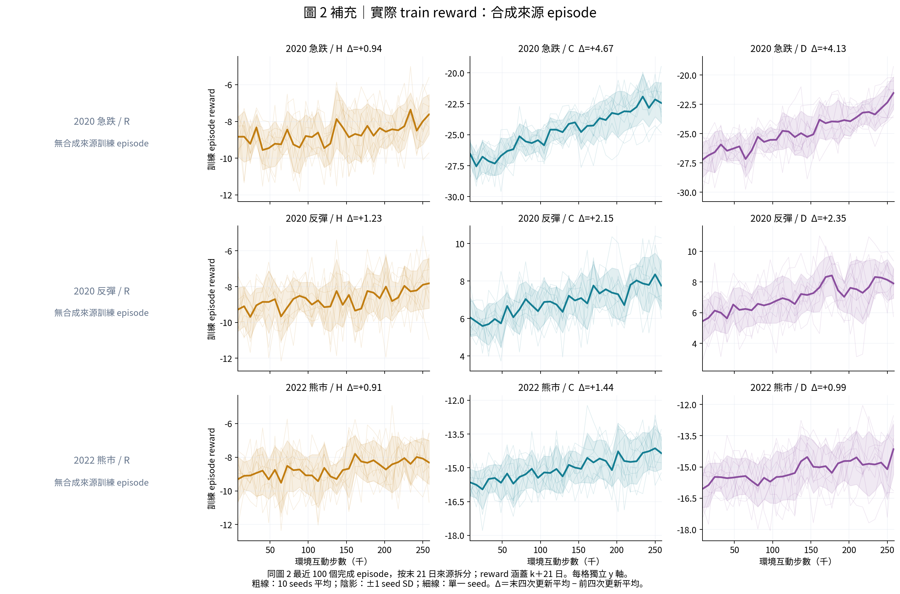
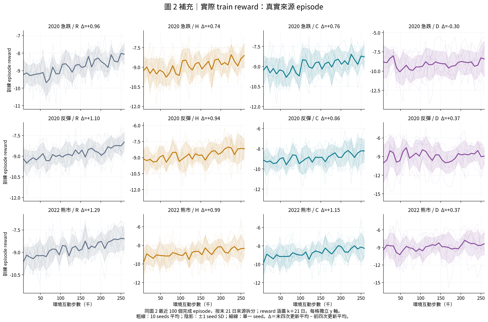

# 實際訓練 reward 的來源拆分

展開：training 合成來源的 reward 曲線

實際隨機 rollout 的合成來源訓練 episode；使用與圖 2 相同的最近 100 個完成 episode，篩出後 21 日為合成資料者，再於每個 seed 內取平均。reward 維持 k＋21 日口徑，因此仍包含前置 k 個真實交易日；H 為歷史條件合成，C／D 為當次 E0 合成。R 沒有合成訓練 episode，以不適用標示。

粗線為 10 seeds 平均、細線為各 seed、陰影為 ±1 seed 標準差；每格採獨立 y 軸。此圖是圖 2 的實際訓練來源拆分，與圖 3 的固定樣本確定性評估不同。來源 [2]。

展開：training 真實來源的 reward 曲線

實際隨機 rollout 的真實來源訓練 episode；使用與圖 2 相同的最近 100 個完成 episode，篩出後 21 日為真實資料者，再於每個 seed 內取平均。reward 同樣涵蓋 k＋21 日；R 的全部 episode 均屬真實來源。粗線為 10 seeds 平均、細線為各 seed、陰影為 ±1 seed 標準差；每格採獨立 y 軸。

例如急跌 D 的真實來源，前四次更新平均 −8.52 → 末四次 −8.82，合成來源則 −26.65 → −22.52；整體 reward 上升不代表兩種來源都改善。

來源拆分從 3,840 個 checkpoint 的最近 100 個 episode reward 與固定環境／k 排程核對重建，未重新訓練或採樣。H／C／D 每個點的每種來源有 48–52 個 episode，R 的真實來源有 100 個；沒有額外為每種來源各取 100 個。逐 seed 按來源樣本數加權後可還原圖 2。此處附合成與真實兩種來源的逐更新數據，另含後 21 日 suffix 與前置 k 日 prefix reward：

[下載來源拆分數據](actual_training_rewards_by_source.csv)

