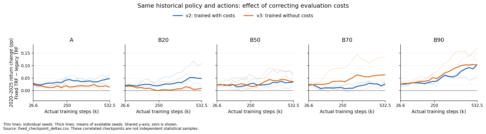
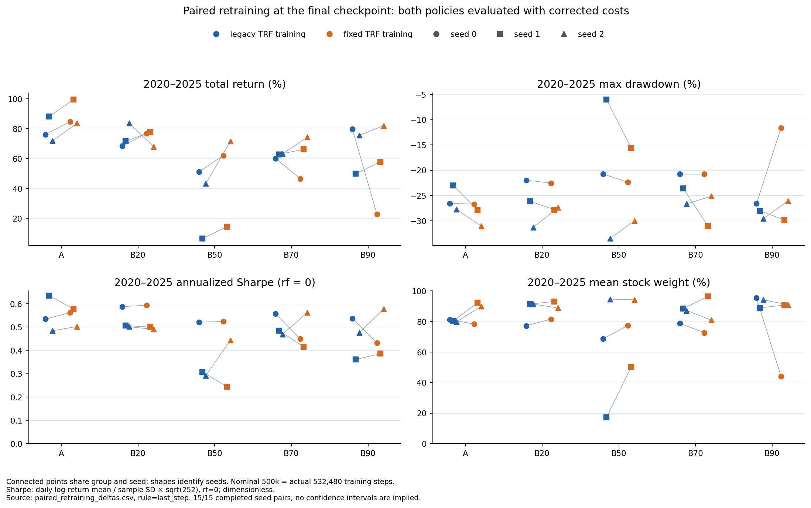

# TRF 修正後，回測與重訓到底改變多少？

完成時間：2026-10-12（台灣）。本輪重測 v2、v3 共 **600 個舊 checkpoint**，並完成 **15 對、共 30 組從頭重訓**；每組名義 500,000 步、實際 532,480 步，保存 20 個 checkpoint。全部 1,200 個 checkpoint 都以新舊 TRF 驗證、回測。[完整檢查紀錄](../audit.json)

**TRF 對固定策略的直接扣費影響很小，但進入訓練 reward 後，會造成大得多且因種子而異的策略差異。修正沒有讓持股隨合成比例單調下降，也沒有消除跨種子差距。**

## 1. 固定模型重新回測：淨值微調，持股幾乎不變

以相同 checkpoint、相同逐日交易動作比較，2020–2025 全期報酬的平均變化為：

- v2：**+0.0322 個百分點**，300 個 checkpoint 的範圍為 −0.0101～+0.1591 個百分點。
- v3：**+0.0326 個百分點**，300 個 checkpoint 的範圍為 −0.0301～+0.1741 個百分點。

這些 checkpoint 是同一訓練軌跡上的相關觀測，不能當作 600 個獨立樣本做顯著性推論。固定 checkpoint 的 observation 只含價格與上一個目標 action，成本不會改變政策輸入；本輪所有評估的最大單日現金權重差僅 **0.000023 個百分點**，屬 float32 正規化誤差。[逐 checkpoint 差異](fixed_checkpoint_deltas.csv)、[檢查紀錄](../audit.json)

同一 checkpoint 的 Sharpe 也僅微調：v2 的平均 Δ Sharpe 為 **+0.000207**（範圍 −0.000054～+0.002381），v3 為 **+0.000250**（−0.000150～+0.004978）。這些是無單位差值。[成本修正明細](fixed_checkpoint_deltas.csv)

重新以 2018–2019 validation 選模，v2 全部 15 組的 final value／Sharpe 選模均不變；v3 的 Sharpe 選模也都不變，只有 **B20、seed 0 的 final value 選模從名義 25,000 改成 250,000 步**。兩者皆用正確 TRF 測試時，平均持股從 **92.09% 降至 88.07%**，全期報酬從 **81.34% 升至 81.44%**。這個持股差異來自換了模型，不能解釋成重新扣費直接降低持股。[選模變更](selection_changes.csv)、[所選模型績效](selected_results.csv)

## 2. 成對重訓：50 萬步終點結果

下表是每組 3 個種子的平均，測試期間為 2020–2025。兩邊都用**修正後的 TRF 回測**，隔離訓練版本的影響；此表固定使用訓練終點，不涉及 validation 選模。最大回撤用負值表示，Δ 為正代表回撤縮小。[成對重訓明細](paired_retraining_deltas.csv)

| 組別 | 全期報酬：舊訓練 → 新訓練（%） | Δ 報酬（百分點） | 平均持股：舊訓練 → 新訓練（%） | Δ 最大回撤（百分點） |
| --- | --- | --- | --- | --- |
| A | 78.75 → 89.28 | +10.53 | 80.45 → 86.92 | -2.78 |
| B20 | 74.61 → 74.19 | -0.42 | 86.70 → 87.89 | +0.56 |
| B50 | 33.60 → 49.34 | +15.75 | 60.23 → 73.91 | -2.54 |
| B70 | 62.03 → 62.34 | +0.31 | 84.79 → 83.39 | -1.97 |
| B90 | 68.43 → 54.28 | -14.15 | 92.87 → 75.28 | +5.54 |

### 終點模型的 Sharpe 比較

沿用實驗原本的 `sharpe_0rf`：**日 log return 的平均 ÷ 樣本標準差 × √252，無風險利率為 0**。Sharpe 及 Δ Sharpe 均無單位，不是百分比或百分點。下表先計算各種子的 2020–2025 Sharpe，再彙整平均 ± 樣本標準差；不等同於三策略合成投資組合的 Sharpe，± 也不是信賴區間。[完整 Sharpe 比較](sharpe_comparison.csv)、[逐種子明細](sharpe_by_seed.csv)

| 組別 | 舊訓練 Sharpe（平均 ± 標準差） | 新訓練 Sharpe（平均 ± 標準差） | 平均 Δ Sharpe | 改善種子 |
| --- | --- | --- | --- | --- |
| A | 0.5511 ± 0.0770 | 0.5477 ± 0.0398 | -0.0034 | 2/3 |
| B20 | 0.5317 ± 0.0483 | 0.5282 ± 0.0574 | -0.0035 | 1/3 |
| B50 | 0.3738 ± 0.1278 | 0.4040 ± 0.1436 | +0.0303 | 2/3 |
| B70 | 0.5034 ± 0.0467 | 0.4755 ± 0.0765 | -0.0280 | 1/3 |
| B90 | 0.4576 ± 0.0890 | 0.4657 ± 0.1003 | +0.0080 | 2/3 |

**報酬、最大回撤與 Sharpe 的改善方向並不一致。** A 的全期報酬增加 10.53 個百分點，但平均 Sharpe 略降；B90 的平均最大回撤改善 5.54 個百分點，平均 Sharpe 卻只增加 0.0080。B90 seed 0 的持股與回撤雖大幅下降，Sharpe 反而由 **0.5365 降至 0.4329**；另外兩個種子的提升才使組平均略升。B50 的平均 Sharpe 增加 0.0303，主要由 seed 2 的 +0.1511 拉動；seed 1 則下降 0.0631。三種子不足以據此判定穩健或顯著改善。

B90 的平均持股下降 **17.58 個百分點**，最大回撤改善 **5.54 個百分點**，但全期報酬下降 **14.15 個百分點**。這主要由 seed 0 拉動：其持股從 **95.42% 降至 44.04%**、報酬從 **79.81% 降至 22.84%**；seed 1 的持股反而從 **88.99% 升至 90.80%**。因此不能只看 B90 平均值就斷言三個種子都學會更一致地避險。

B50 呈現相反方向：平均持股增加 **13.68 個百分點**，報酬增加 **15.75 個百分點**，但平均最大回撤惡化 **2.54 個百分點**。A、B20、B50、B70、B90 的修正後平均持股依序為 **86.92%、87.89%、73.91%、83.39%、75.28%**，仍非單調下降。

### 種子差異仍然很大

以下標準差使用 3 個種子的樣本標準差，描述本輪離散程度，不是信賴區間。[終點跨種子統計](last_step_seed_spread.csv)

| 組別 | 舊訓練持股標準差（百分點） | 新訓練持股標準差（百分點） | 新訓練三種子持股範圍（%） |
| --- | --- | --- | --- |
| A | 0.63 | 7.48 | 78.41～92.49 |
| B20 | 8.17 | 5.87 | 81.58～93.19 |
| B50 | 39.36 | 22.26 | 50.14～94.26 |
| B70 | 5.23 | 12.06 | 72.68～96.45 |
| B90 | 3.42 | 27.06 | 44.04～91.01 |

B50 的持股差距縮小，B90 的差距卻擴大。這說明 TRF 錯誤會影響學習路徑，但不是跨種子不穩定性的完整解釋；這次實驗沒有分別消融 PPO 最佳化、初始參數、短 episode 或 reward 設計，不能把剩餘差距歸因於其中單一因素。

### 選模規則會改變結論

若按修正後 validation final value 選模，B90 的平均全期報酬差異為 **+2.28 個百分點**，持股差異僅 **−1.12 個百分點**；若按 Sharpe 選模，則為報酬 **−9.36**、持股 **−8.28 個百分點**。因此「訓練終點明顯降持股」不能推廣成「所有可選 checkpoint 都明顯降持股」。三種規則的完整組別數值均保留於[完整比較表](README.md#相同環境的成對重訓)，選模全程只使用 validation。

三種規則下的**測試期平均 Sharpe（舊訓練 → 新訓練）**如下；每格均為 3 個種子，兩邊都用正確成本選模及測試。`依 validation Sharpe` 是選模規則，不代表測試 Sharpe 一定最高。

| 組別 | 訓練終點 | 依 validation final value | 依 validation Sharpe |
| --- | --- | --- | --- |
| A | 0.5511 → 0.5477 | 0.5558 → 0.5768 | 0.5531 → 0.5862 |
| B20 | 0.5317 → 0.5282 | 0.5342 → 0.5318 | 0.5509 → 0.5270 |
| B50 | 0.3738 → 0.4040 | 0.4508 → 0.4999 | 0.4069 → 0.4172 |
| B70 | 0.5034 → 0.4755 | 0.5613 → 0.5332 | 0.5336 → 0.5695 |
| B90 | 0.4576 → 0.4657 | 0.5440 → 0.5673 | 0.5604 → 0.5441 |

B70 的終點平均 Sharpe 下降 **0.0280**，依 validation Sharpe 選模後則增加 **0.0360**，三個種子都改善；B90 依 validation final value 選模增加 **0.0232**，依 validation Sharpe 選模卻下降 **0.0163**。這些結果須分開解讀，不以測試期的最佳規則倒推選模。[全部規則與標準差](README.md)

## 3. 下跌期間：B90 平均改善，其他組別不一致

下表仍採用終點模型，數值是三種子平均的「新訓練 − 舊訓練」，報酬、回撤與持股差異的單位為百分點，Δ Sharpe 則無單位。2020 是全年視窗，不是只截取疫情崩跌交易日；GFC 為 2008-01-02～2009-06-30。[壓力期間彙整](stress_period_summary.csv)

| 期間 | 組別 | Δ 報酬 | Δ 最大回撤 | Δ 平均持股 | Δ Sharpe |
| --- | --- | --- | --- | --- | --- |
| 2020 | A | -1.32 | -2.19 | +5.94 | -0.1029 |
| 2020 | B20 | +1.06 | -0.29 | +0.84 | +0.0211 |
| 2020 | B50 | +2.59 | -2.58 | +10.84 | -0.1263 |
| 2020 | B70 | -0.59 | -1.77 | -1.19 | -0.0705 |
| 2020 | B90 | -3.08 | +5.21 | -16.48 | -0.0328 |
| 2022 | A | -2.69 | -3.24 | +6.11 | -0.0582 |
| 2022 | B20 | +2.21 | +0.53 | +2.32 | +0.1371 |
| 2022 | B50 | -1.56 | -2.64 | +13.19 | +0.0314 |
| 2022 | B70 | -1.56 | -2.05 | -1.91 | -0.0585 |
| 2022 | B90 | +3.25 | +5.49 | -20.10 | -0.0279 |
| gfc | A | -2.97 | -4.18 | +6.34 | -0.0402 |
| gfc | B20 | +1.32 | +0.44 | +1.37 | +0.0208 |
| gfc | B50 | +0.47 | -2.84 | +8.82 | +0.1292 |
| gfc | B70 | +0.83 | +0.45 | -2.09 | +0.0480 |
| gfc | B90 | +3.94 | +7.20 | -20.10 | +0.0896 |

B90 在 2022 與 GFC 的平均報酬分別改善 **3.25、3.94 個百分點**，最大回撤改善 **5.49、7.20 個百分點**；代價是在完整 2020–2025 上漲期間減少參與。其他組別的回撤效果混合，無法據此認定修正後所有模型的暴跌反應都已改善。GFC 雖早於 FinRL 訓練期，TimeDiff 生成器曾看過 2008 年，不能稱作整套流程完全未見的資料。

B90 的 GFC 平均 Sharpe 從 **−0.2612 升至 −0.1716**，但 2022 從 **−0.9732 降至 −1.0010**。2022 的報酬與最大回撤改善，未轉化為 Sharpe 改善；當平均報酬為負時，波動降低也可能讓負 Sharpe 更低，不能只以 Sharpe 評斷避險成效。

## 4. 為何總回測差異小，重訓差異卻大？

固定價格、費率 0.25%、由全現金買入再賣出的簡例中，舊 TRF 買入扣費為零、賣出扣約 0.500625%；新 TRF 買入與賣出各扣 0.25%，來回損失約 0.499375%。來回總差異只有約 **0.00125 個百分點**，但負 reward 從賣出時集中發生，改為分散在買賣兩步。[實際程式演算](../trf_flat_price_roundtrip.csv)

PPO 會用每步 reward 計算 advantage；舊公式加重降低持股的即時代價，也少算提高持股的即時代價。修正會改變參數更新與後續動作，即使固定策略的長期費用差異近乎抵消。這是與結果一致的機制說明，不代表已單獨證明各個種子的變化原因；本輪比較包含現金項修正與 float64 迭代兩部分。

兩邊都維持原本的每步 log-return reward，沒有新增回撤懲罰；訓練 reset 仍直接建立股票與現金各 1/11 的初始配置。報表步數修正只把名義 checkpoint 對齊實際 PPO 步數，本輪兩邊的預算與 reward 對齊相同。

## 5. 可以採用哪些結果？

- **v2／有成本訓練**：使用本輪 `paired_fixed` 模型及 `evaluations/paired_fixed` 的正確 TRF 評估。舊 v1、v2 Sharpe 的 30 個已選模型，均已確認與對應 v2 reward logging checkpoint 政策參數相同，因此本輪舊模型重測也涵蓋它們。[模型對照](../legacy_selected_model_equivalence.csv)
- **v3／零成本訓練**：沿用原 300 個 checkpoint 即可；已全部重新驗證、選模與測試。TRF 費率為零時不影響訓練更新，且原訓練沒有 validation early stopping，無須重做零成本訓練。
- **歷史報表**：保留原檔；本輪正確成本結果集中在此目錄，不將舊資料夾改寫成新結果。舊訓練與新訓練的差異請採本輪同環境的成對比較。

原模型是 PyTorch 2.9.1，本輪成對重訓是 2.13.0；兩邊均使用本地相同版本、CPU、相同種子／資料／超參數。舊模型在本地用舊 TRF 的最大報酬重現誤差約 **0.00184 個百分點**，60 個歷史選模結果全部重現一致。[重現誤差](historical_reproduction.csv)、[選模重現](../historical_selection_reproduction.csv)

本次新增 Sharpe 表格與圖表，既有結果 CSV 保持逐位元組一致；另外從逐日淨值獨立重算 720 個 Sharpe，全部吻合。[Sharpe 補充檢查](../sharpe_report_audit.json)

完整性檢查確認：15／15 對 episode 抽樣序列與設定相同、600 個新 checkpoint 的訓練當下 validation 與獨立重測指標完全一致、1,200 個模型 ZIP／雜湊／實際步數正確、2,400 筆 validation 與 19,200 筆測試指標完整且有限。33 項相關測試通過。[資料與執行環境](../manifest.json)、[原始碼記錄](../scientific_source_manifest.json)、[驗證重現明細](../training_validation_reproduction.csv)、[檢查結果](../audit.json)

可選 QuantStats 終端圖表在 worker 中停用，以避開本地 SciPy 載入問題，不參與訓練或績效計算。一次回測因 float32 持股正規化誤差超過最初容差而中止；已加入獨立解析式檢查並完整重測，未改動訓練或成本公式。[處理紀錄](../rounding_check_recovery.json)

重跑命令見[分析工具說明](../../../../analysis/scenario_mix/README.md#trf-修正前後的成對實驗)。checkpoint、逐日壓縮 CSV、指標彙整、檢查紀錄及本報告一併納入版本管理；工作 log、鎖檔與暫存進度保留在本地。原始價格與合成資料依 manifest 記錄的路徑及 SHA-256 取得。
